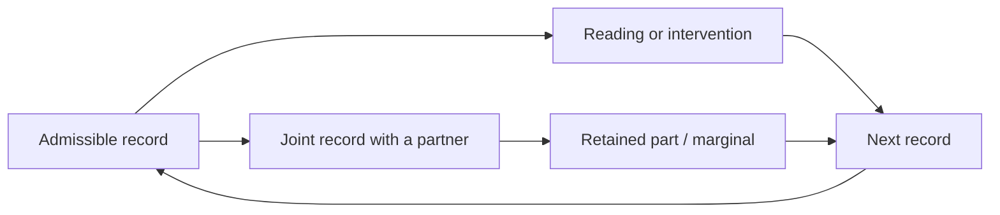
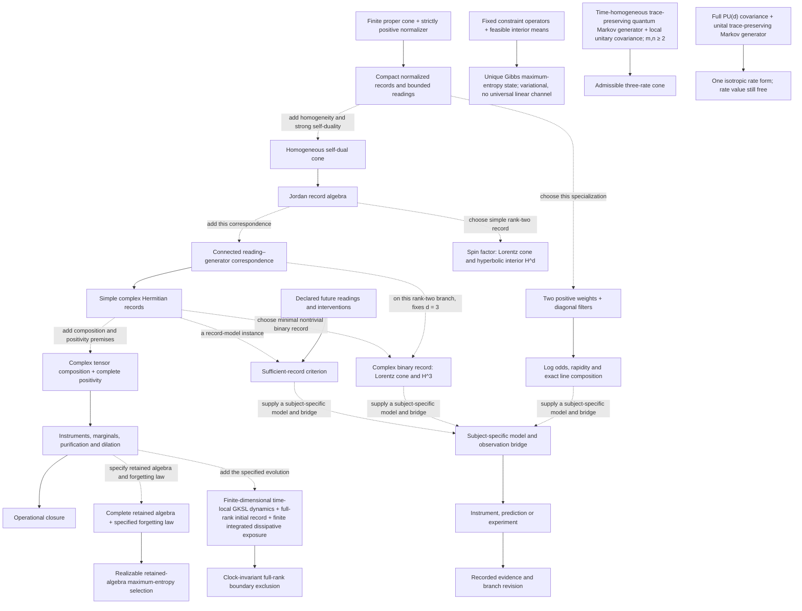

# The structure of The Bounded Observer

The project has one root question: **what must an observer retain to read, predict or change something lawfully?** A record is sufficient only relative to the future readings and interventions it must support. The operation class comes with the state description.

UHL supplies the operational geometry of bounded normalized readings in specified positive record models. SIH studies field regularity and concentration within declared dynamics. IDA, VCC and the wider branches supply concrete observation and intervention problems. Their unity is the common operational question and explicit dependency map.

The practical task is to find which distinctions matter. Two histories can share a summary yet have different conditional future readings under the same allowed operation. That summary then loses a necessary distinction. Histories that agree for every declared future operation can share one operational state. Instruments and models investigate those equivalence classes in their own subjects; the framework supplies the language for stating and checking the problem.

## What closes

**[P, conditional]** The current capstone closes the finite complex record model under serial and parallel instruments, selective updates, mixing, composition and discarding. Purification and environment dilation connect part and whole descriptions. The result is closure of a declared operation class, with its premises stated.

[Capstone Parts I–V](../papers/library-2026-10-12/papers/capstone.md) provide the proofs and distinguish this closure from unique physical state or constant selection.

## Which deductions use which premises

**[P, conditional]** The mathematical arrows hold with their displayed premises. Application arrows are interfaces: a branch must supply their inputs.

The line construction is independently usable ([Paper 2](../papers/library-2026-10-12/papers/paper2.md)). A classical population model or general predictive-state application need not inherit the complex classification premises. A measurement being positive does not by itself show that its mechanism is quantum or hyperbolic. A simple rank-two homogeneous self-dual record already has a Lorentz cone and hyperbolic interior H^d; the connected correspondence fixes d = 3. The two-weight line has its projective chart and tanh composition without intrinsic sectional curvature. Fixed-mean Gibbs selection is variational, and equilibrium alone does not select the dynamical generator; Paper 8 states the covariance-dependent rate classifiers.

## How the physical models attach

| Model | Required attachment | Current source |
| --- | --- | --- |
| Light and time | Identify event displacements, null signals and a calibrated clock with the binary cone | [Paper 3](../papers/library-2026-10-12/papers/paper3.md) |
| Composite quantum records | Declare complex tensor composition, complete positivity and actual instruments/dynamics | [Paper 4](../papers/library-2026-10-12/papers/paper4.md) |
| SIH and fields | Supply the field equation, source/target geometry, energy normalization and initial/boundary data | [Paper 5](../papers/library-2026-10-12/papers/paper5.md) |
| Matter and gauge structure | Supply the physical local-frame interpretation, representations and action; anomaly results use a specified chiral family | [Paper 6](../papers/library-2026-10-12/papers/paper6.md) |
| Gravity | Supply Lorentzian horizons, area entropy, Unruh temperature, local equilibrium, Clausius balance and conservation | [Paper 7](../papers/library-2026-10-12/papers/paper7.md) |
| State selection and constants | Specify the retained algebra, generator, preparation/data map and observable | [Paper 8](../papers/library-2026-10-12/papers/paper8.md) |

Gravity has two separate directions. **[P, conditional]** Einstein vacuum equations plus stationary symmetry yield a hyperbolic Ernst map. Independently, the stated local-horizon thermodynamic premises yield a conditional Einstein equation. The Ernst reduction is not the premise set for the thermodynamic derivation.

The word *boundary* has three meanings that a branch must distinguish: a record's rank/projective edge; supplied preparation or boundary data; and a physical signal or geometric horizon. Any identification among them requires that branch's bridge.

## Natural extensions

A branch belongs to the programme when it exposes the [common contract](branch-contract.md) and a specific question about records, operations or retained information. Its relationship can be a proved consequence, a conditional specialization, an instrument, an experiment or a proposed extension.

| Branch | Place in the programme |
| --- | --- |
| [Physical models and SIH](../branches/physics/README.md) | Geometry, composition, clocks, fields, matter, gravity and selection |
| [Adaptation and biology](../branches/adaptation/README.md) | Positive response models, growth, resources, recovery, hormesis, ecology and pharmacology |
| [IDA](../branches/ida/README.md) | Measuring distinctions that could alter an intervention |
| [Observatory cell flights](../branches/cell-flights/README.md) | Earlier held-out cellular-response experiments |
| [Arc VCC](../branches/vcc/README.md) | Official cellular-perturbation competition and its distinct implementation |
| [Scientific AI](../branches/scientific-ai/README.md) | Retained evidence, dependency-aware memory and warranted actions |
| [Arithmetic](../branches/arithmetic/README.md) | Projection and refinement in exact number-theoretic constructions |
| [Evidence and decisions](../branches/evidence-decisions/README.md) | Source and decision standards; historical domain work with incomplete operational mappings |
| [Philosophy and human experience](../branches/philosophy/README.md) | Source-traceable interpretation, a continuous human journey and defended ethical commitments |

The [branch registry](../registry/branches.json) records the relationships and supporting sources. Branches can share methods or instruments without one being a theorem of another. IDA asks whether a measured distinction improves an action; VCC asks whether retained cellular information predicts a response. Both use observation, retention and intervention, while their biological bridges and success criteria differ. The earlier GitHub Virtual Cell laboratory and the Arc competition have separate branch identifiers and evidence histories.

## One public entrance

`bounded-observer` holds the current library, shared definitions, branch catalogue and public explanation. Component repositories hold independently maintained applications, large laboratory workflows and source histories. Their landing pages point here and name their roles.

The six-gate walk remains a teaching route for state, action and composition. Its C1–C4 capstone is a frozen specialization, alongside the current record library. The historical atlas remains available with current correction pointers.

Repository count is an engineering decision. The framework supplies the criterion for conceptual membership and lawful explanation: declared records and operations, explicit dependencies, and evidence that belongs to the claim being made.
